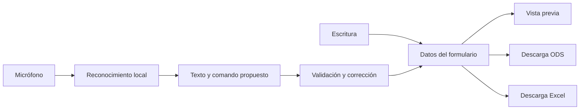

# JOSU: análisis de llenado por voz y vista previa

Fecha: 24 de octubre de 2026. Este documento propone las siguientes etapas; no añade funciones de voz ni de vista previa a la web actual.

## Recomendación

Sí es posible añadir ambas funciones. Conviene mantener un único formulario como fuente de datos: la escritura, el dictado, la vista previa y las descargas deben usar los mismos valores y validaciones.

Recomiendo empezar con dictado por campo y una vista previa local de la solicitud. Después, incorporar comandos, dictado de varios campos y más documentos. La reproducción exacta de la impresión debe validarse con un motor de oficina y las fuentes del archivo. Una imagen que se parece a la planilla no demuestra que el archivo final imprima igual.

La aplicación actual tiene 146 campos, nueve secciones y una plantilla de 23 hojas. Ya existe un mapa entre campos y celdas, y los exportadores ODS y XLSX conservan sus respectivas plantillas. Es una base útil para estas mejoras.

## 1. Cómo debería funcionar la voz

La primera versión tendría un botón de micrófono en el campo activo. La persona lo pulsa, dicta y ve el texto reconocido antes de aplicarlo. Debe poder corregirlo con teclado, repetirlo o deshacer el último cambio. El audio no se guarda por defecto.

El campo activo determina cómo interpretar el texto. Un nombre se trata como texto; un monto, como número; y una cédula, teléfono o cuenta, como identificador que conserva los ceros iniciales.

| Frase de ejemplo | Acción propuesta |
| --- | --- |
| «Nombre del solicitante: Ana Pérez» | Proponer el nombre en el campo del solicitante. |
| «Cédula: cero cero uno dos tres cuatro cinco, La Paz» | Proponer `0012345 LP`, conservando los ceros. |
| «Monto solicitado: ciento veinte mil bolivianos» | Proponer el número `120000`. |
| «Nacimiento: cuatro de mayo de mil novecientos noventa» | Proponer `1990-05-04`. |
| «Ir a garante uno» | Cambiar a esa sección. |
| «Siguiente campo», «anterior campo» | Navegar dentro del formulario. |
| «Deshacer» | Restaurar el valor anterior, o el lote anterior si se aplicaron varios campos juntos. |
| «Revisar solicitud» | Mostrar los datos y campos pendientes. |

Los comandos deben ser explícitos para distinguirlos del texto libre de una dirección o comentario. «Borrar formulario» requiere una confirmación. Una frase ambigua no debe cambiar varios campos silenciosamente. La descarga puede seguir usando el botón actual, incluso cuando el formulario se complete por voz.

En una segunda etapa se puede admitir: «Solicitante Ana Pérez, cédula…, celular…, dirección…». Primero se mostraría una lista de cambios propuestos y luego se aplicarían como una sola operación que se pueda deshacer. No hace falta empezar con un modelo de lenguaje: un catálogo de nombres de campos, sinónimos y reglas cubre los comandos iniciales.

## 2. Motores que vale la pena probar

| Alternativa | Ventaja para JOSU | Límite que hay que medir | Decisión propuesta |
| --- | --- | --- | --- |
| Transformers.js + Whisper multilingüe | Reconocimiento en el navegador; ejecución con WASM o WebGPU según el equipo. | Descarga inicial, memoria, velocidad y exactitud con nombres y español local. | Candidato principal para dictado; probar `whisper-tiny` multilingüe antes de subir de tamaño. |
| Vosk en WebAssembly | Reconocimiento local con resultados parciales y ejecución en un Web Worker. | Calidad con apellidos, ruido y direcciones; revisar el estado del envoltorio del navegador. | Compararlo con Whisper en móviles modestos y comandos breves. |
| Web Speech API | Integración inicial pequeña cuando el navegador la admite. | Compatibilidad limitada; algunas implementaciones envían audio a un servicio remoto. | Opción secundaria, sin asumir que funcionará igual en Chrome y Brave. |

Transformers.js documenta reconocimiento de audio en el navegador y ejecución con WASM/WebGPU. Para español hay que usar un modelo multilingüe; una variante terminada en `.en` está orientada a inglés. [Documentación de Transformers.js](https://huggingface.co/docs/transformers.js/en/index), [modelo ONNX Whisper Tiny](https://huggingface.co/onnx-community/whisper-tiny).

Vosk ofrece un modelo pequeño de español de aproximadamente 39 MB. El proyecto indica que los modelos pequeños suelen necesitar bastante más memoria en ejecución que su tamaño de descarga. Esto debe medirse en el teléfono real. El envoltorio `vosk-browser` ejecuta el motor en un Web Worker; su ejemplo usa una API de audio antigua, por lo que conviene evaluar una adaptación a AudioWorklet. [Modelos oficiales de Vosk](https://alphacephei.com/vosk/models), [repositorio de vosk-browser](https://github.com/ccoreilly/vosk-browser).

La Web Speech API tiene disponibilidad limitada y puede usar servicios externos. No sería la única dependencia de una aplicación que busca funcionar en distintos navegadores y mantener el procesamiento local. [SpeechRecognition en MDN](https://developer.mozilla.org/en-US/docs/Web/API/SpeechRecognition).

La elección final debería salir de una prueba comparativa con las mismas grabaciones, no de una promesa de precisión. Usaría frases sintéticas y muestras autorizadas con montos, fechas, ceros iniciales, apellidos bolivianos y ruido de oficina.

## 3. Integración sin perder rapidez

- Cargar el motor y su modelo solamente al activar voz. El formulario normal debe seguir siendo ligero.
- Descargar y almacenar el modelo aparte de la caché básica de la aplicación. Mostrar progreso y permitir eliminarlo.
- Procesar audio en AudioWorklet y reconocimiento en un Worker cuando la biblioteca lo permita. Evitar trabajo pesado en el hilo de los campos.
- Mantener estados claros: descargando, escuchando, transcribiendo, pendiente de aplicar y error.
- Detener el micrófono al pulsar detener, salir de la función o cuando la aplicación deje de estar activa. No prometer escucha en segundo plano en móviles.
- No enviar audio ni formularios a servicios externos por defecto. El permiso del micrófono se pide cuando la persona pulsa el botón correspondiente.
- Reutilizar las validaciones de `src/schema.ts` y el estado del formulario. No escribir directamente dentro de un archivo ODS durante el dictado.

## 4. Vista previa durante el llenado

**Sí es viable.** Hay que distinguir una vista útil para revisar datos de una representación de impresión calculada por Excel o LibreOffice.

| Enfoque | ¿Funciona solo con GitHub Pages? | Fidelidad | Coste y uso recomendado |
| --- | --- | --- | --- |
| Páginas de la plantilla fija con una capa de datos en SVG/HTML | Sí; también puede funcionar sin conexión. | Alta para la plantilla fija si se mapean bien los campos; los ajustes de texto requieren comprobación. | Mejor primera etapa para JOSU. |
| Visor de celdas construido a partir del XML de la planilla | Sí. | Útil para revisar valores; reproducir impresión, imágenes y tipografía exige mucho trabajo. | Alternativa para una vista de hoja, no para prometer impresión idéntica. |
| Generar PDF con LibreOffice en un servidor y verlo con PDF.js | El formulario sí; el motor de conversión necesita otro alojamiento. | Basada en el motor y las fuentes del servidor; verificable frente a ese mismo entorno. | Adecuado si la prioridad pasa a ser revisar cada página impresa. |
| Integrar un visor/editor de oficina como ONLYOFFICE | Requiere servicios adicionales. | Motor de oficina completo; aún necesita validar la conversión del documento. | Mayor infraestructura de la necesaria para la primera versión. |

PDF.js permite mostrar PDF en el navegador; no convierte un ODS o XLSX a PDF. LibreOffice ofrece conversión mediante línea de comandos. ONLYOFFICE documenta servicios de edición, almacenamiento y conversión en el servidor. [PDF.js](https://mozilla.github.io/pdf.js/getting_started/), [conversión de LibreOffice](https://help.libreoffice.org/latest/en-US/text/shared/guide/convertfilters.html), [arquitectura de ONLYOFFICE](https://api.onlyoffice.com/docs/docs-api/get-started/how-it-works).

### Primera etapa recomendada: vista local de la plantilla fija

1. Exportar una vez las páginas vacías de la plantilla desde el motor de oficina elegido.
2. Preparar un mapa: campo → celdas dependientes → página → posición, tamaño, alineación y formato.
3. Mostrar la página original como fondo y dibujar los valores del formulario en una capa superpuesta.
4. Empezar con la solicitud; después añadir croquis, autorizaciones y declaraciones.
5. Resaltar el dato que se acaba de editar y permitir saltar desde la vista previa al campo correspondiente.

Este enfoque aprovecha que la plantilla siempre es la misma. Se puede usar en GitHub Pages sin enviar datos a un servidor. Sin embargo, no es un motor completo de Calc: textos largos, saltos de línea, fuentes y cambios de paginación deben probarse. La interfaz debe identificarla como vista previa y no como certificación de impresión exacta.

En escritorio: formulario y documento lado a lado, con selector de documento, página y zoom. En móvil: pestañas «Formulario» y «Vista previa» para no reducir ambos a un tamaño ilegible. El usuario puede mantener la vista cerrada para ahorrar memoria.

### Si se necesita fidelidad de impresión

La alternativa es generar el archivo final con los exportadores existentes y convertirlo a PDF con un motor de oficina. La vista mostraría ese PDF. El resultado refleja ese motor concreto; no garantiza que todos los motores y versiones impriman igual.

GitHub Pages puede conservar el frontend, pero no ejecutar ese servicio. Haría falta un backend separado y archivos temporales aislados por sesión. No sería obligatorio añadir cuentas al formulario. Sí sería necesario definir dónde se procesan los documentos y cuándo se eliminan. No recomendaría un visor público que obligue a publicar el expediente en una URL accesible por terceros.

## 5. Cómo actualizar la vista sin bloquear el formulario

No hay que descomprimir y volver a comprimir las 23 hojas después de cada tecla. La vista necesita datos y resultados vinculados, no un ZIP nuevo continuamente.

La propuesta es extraer del exportador ODS el cálculo de cambios y dependencias como módulo compartido. La vista y las descargas usarían ese mismo módulo. La generación de los archivos seguiría ocurriendo al descargar.

Actualizar únicamente la página visible y agrupar cambios con una pequeña espera tras dejar de escribir. Un objetivo inicial de 150–300 ms para la vista local es razonable como meta de prueba, no como rendimiento ya medido. En dictado, los resultados parciales se muestran en la transcripción; solo el texto aplicado cambia el documento. Así se evitan saltos constantes y valores todavía incompletos.

En la alternativa de PDF remoto, cancelar peticiones obsoletas y actualizar al terminar una frase o tras una pausa mayor. La conversión puede tardar segundos; no conviene presentarla como actualización instantánea.

## 6. Orden de implementación

| Etapa | Entrega concreta | Cómo se decide si funciona |
| --- | --- | --- |
| A | Prueba de Whisper y Vosk, sin modificar expedientes. | Medir errores por campo, consumo y latencia en Chrome, Brave y móviles reales. |
| B | Dictado del campo activo, corrección y deshacer. | Montos y fechas se validan; CI, cuentas y teléfonos conservan todos sus caracteres. |
| C | Vista previa local de la solicitud. | Mismos datos que el archivo descargado; probar nombres y direcciones largos. |
| D | Comandos y cambios de varios campos como un lote. | Se ve qué campos cambiarán y se puede deshacer el lote completo. |
| E | Más documentos y, si hace falta, PDF con motor de oficina. | Comparación página por página con el archivo final y el motor seleccionado. |

## 7. Pruebas que importan

Probar el flujo completo: dictar → revisar → aplicar → ver el cambio → descargar ODS y XLSX → abrirlos y comprobar las mismas celdas. Incluir ceros iniciales, extensiones de CI, montos decimales, fechas, campos vacíos, nombres extensos y correcciones consecutivas.

En dispositivos, comprobar permisos denegados, micrófono ocupado, falta de WebGPU, poca memoria, primer uso sin modelo descargado y uso sin conexión después de descargarlo. Los objetivos deben medirse con los teléfonos que realmente se utilizarán.

La primera prueba de vista previa debería cubrir la solicitud y sus datos vinculados. Las hojas financieras independientes todavía requieren sus entradas específicas: ni la voz ni una vista previa deben inventar los datos que falten.

## Decisión propuesta para la siguiente versión

Mantener la web actual ligera. Añadir primero dictado local por campo y una vista previa local de la solicitud, con corrección visible. Elegir el motor de voz después de una comparación breve en teléfonos reales. Reservar la vista PDF con servidor para cuando la comprobación exacta de impresión justifique esa infraestructura.
